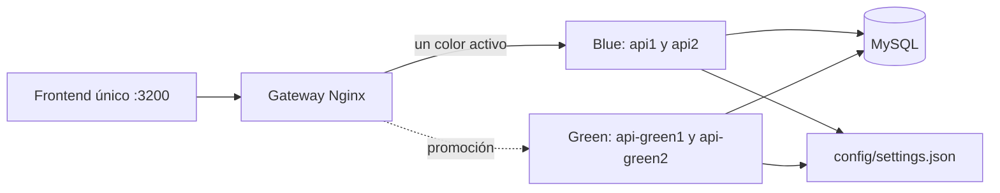

# ANDIS · TFU UT4 — API y consola de demostración

Aplicación de juegos que evoluciona las TFU anteriores. FastAPI, SQLAlchemy, MySQL,
Redis, Keycloak, React y Docker Compose. No requiere Kubernetes.

## Inicio

Con Docker Desktop iniciado, desde la raíz:

```powershell
docker compose up -d --build
```

Compose inicia el frontend, gateway, dos réplicas Blue, dos Green, MySQL, Redis y
Keycloak. Si no existe `.env`, copiar `.env.example` antes de iniciar.

| Servicio | Puerto predeterminado | Configuración |
|---|---|---|
| Frontend | http://localhost:3200 | `FRONTEND_PORT` |
| API / gateway | http://localhost:8000 | `API_PORT` |
| Swagger | http://localhost:8000/docs | `API_PORT` |
| Keycloak | http://localhost:8081 | `KEYCLOAK_PORT` |

El `.env` local puede usar otros puertos (por ejemplo API 18000 y Keycloak 18081).
Si se cambia el puerto de Keycloak, ajustar también `OIDC_ISSUER`, `KEYCLOAK_URL`
y `BASE_URL` cuando corresponda. Las APIs no publican puertos hacia el host.

| Cuenta de demostración | Contraseña | Rol |
|---|---|---|
| demo@adaii.local | Demo123! | user |
| segundo@adaii.local | Demo123! | user |
| admin@adaii.local | AdminDemo123! | admin |

El frontend usa Authorization Code + PKCE. La API valida tokens de Keycloak;
`POST /auth/login` permanece retirado (410).

Para una instalación previa de Keycloak, el archivo de importación no actualiza un
realm existente: verificar que el cliente público `andis-frontend` tenga como
redirect URI `http://localhost:3200/*`, origen `http://localhost:3200` y PKCE S256.
Actualizar ese cliente en la consola de administración sin borrar su volumen.

```powershell
docker compose ps
docker compose logs --tail=100
docker compose down
```

`down` conserva los datos. No agregar `-v` si se quieren preservar los volúmenes.

## Demos UT4

| Atributo | Patrón o estrategia | Prueba desde la consola |
|---|---|---|
| Disponibilidad | Health Endpoint Monitoring | Estado de réplicas del color que responde y readiness de dependencias. |
| Disponibilidad | Throttling | Ráfaga con 429 frente a tráfico a ritmo controlado. |
| Rendimiento | Cache-Aside | HIT/MISS, latencias e invalidación después del commit. |
| Rendimiento | CQRS | Comandos de compras y proyecciones de lectura y agregación. |
| Seguridad | Federated Identity | OIDC/PKCE, firma del token, identidad y roles; casos 200/401/403/410. |
| Seguridad / rendimiento | Gateway Offloading | gzip, estáticos y políticas centralizadas en Nginx. |
| Facilidad de modificación | External Configuration Store | Editar JSON externo compartido y observar el cambio sin rebuild ni reinicio. |
| Facilidad de despliegue | Blue/Green | Verificar y promover el otro color manteniendo estable el frontend. |

CQRS separa modelos dentro del mismo backend y MySQL: no implica que existan
despliegues de lectura y escritura independientes. Las mediciones del navegador
son demostraciones funcionales, no un benchmark exhaustivo.

## Blue/Green solo del backend



Blue usa inicialmente imagen versión 1.0 y Green versión 2.0. `BLUE_VERSION` y
`GREEN_VERSION` son argumentos de construcción; `API_IMAGE` y `GREEN_IMAGE`
permiten seleccionar imágenes ya construidas. Cada color tiene dos réplicas.

En la página **Blue/Green Deployment**, iniciar sesión como admin y elegir
**Dirigir tráfico a Green** o **Dirigir tráfico a Blue**. El gateway comprueba
liveness, readiness, color y coincidencia de versión de las dos réplicas destino,
valida la configuración Nginx, recarga sus workers y verifica una respuesta del
nuevo color. Si no puede promover, conserva/restaura el upstream anterior.

El controlador corre dentro del contenedor gateway, en un puerto interno no
publicado. La API autoriza las acciones con rol admin; no se monta el socket de
Docker ni se ejecutan comandos arbitrarios desde el navegador.

El volumen `gateway_state` conserva el color y el historial de promociones. El
frontend, MySQL, Redis y Keycloak no se reinician al cambiar de color. Las
solicitudes que ya estaban en curso pueden terminar en el color anterior.

Alternativa por consola (el acceso Docker del host administra el gateway):

```powershell
.\scripts\promote.ps1 green
.\scripts\promote.ps1 blue
python scripts/manage.py demo_blue_green
```

```bash
bash scripts/promote.sh green
python3 scripts/manage.py demo_blue_green
```

La demo CLI observa solicitudes durante el cambio, verifica balanceo y vuelve al
color original. Para probar un rechazo, detener una réplica del color inactivo,
intentar promoverlo y recuperarla al terminar:

```powershell
docker compose stop api-green2
# Intentar promover Green desde la consola; debe rechazarse si Blue está activo.
docker compose start api-green2
```

Las dos versiones comparten datos: sus esquemas y formatos de caché deben ser
compatibles durante la transición. Cambiar de color no revierte operaciones de
negocio ni migraciones de la base.

## External Configuration Store con JSON

`config/settings.json` se monta como directorio compartido en las cuatro APIs,
fuera de las imágenes. El archivo no contiene credenciales:

```json
{
  "revision": 1,
  "settings": {
    "cache_ttl_seconds": 60,
    "winter_discount_percent": 50,
    "purchases_enabled": true,
    "store_notice": "Bienvenido a la tienda de juegos"
  }
}
```

En **External Configuration Store**, admin puede editar `settings` y guardar.
También se puede editar el documento completo en el host con un editor de texto.
Las APIs vuelven a leer y validar el JSON al usarlo; el frontend observa los
cambios cada tres segundos. No es necesario reiniciar ni construir una imagen.

Demostración:

1. Cambiar `winter_discount_percent` de 50 a 30: costo base 100 pasa de 50 a 70.
2. Ver mismo hash y revisión en las cuatro réplicas con las mismas versiones.
3. Cambiar `store_notice` y verlo en Tienda.
4. Poner `purchases_enabled` en false: el backend rechaza nuevas compras (503).
5. Editar `cache_ttl_seconds`: las nuevas entradas usan ese TTL; las existentes
   mantienen su vencimiento previo.

Se validan tipos y rangos, se rechazan campos desconocidos y las actualizaciones
desde la API usan reemplazo atómico, lock compartido y control de concurrencia por
hash (409 ante una edición desactualizada). La revisión se incrementa al guardar
desde la API. Las modificaciones manuales se detectan por hash aunque no cambien
la revisión. Ante un archivo inválido cada proceso conserva su última lectura
válida y expone una advertencia; sin una lectura previa válida responde 503.

```powershell
notepad .\config\settings.json
python scripts/manage.py demo_configuration
```

La demo CLI cambia temporalmente el descuento y restaura exactamente el archivo.
Un JSON montado es adecuado para esta demo en un único host; su disponibilidad y
el control de escritura dependen del sistema de archivos compartido.

## Demos antiguas

El menú del frontend contiene una sección desplegable **Demos antiguas**:

| Unidad | Demos |
|---|---|
| UT2 · Tácticas | Strategy y auditoría; rollback de imagen defectuosa. |
| UT3 · Soluciones | Componentes e interfaces / contenedores; escalabilidad horizontal; servicios sin estado; transacciones ACID. |

La clasificación sigue las propuestas de UT2 (tácticas) y UT3 (componentes,
escalabilidad, contenedores, ACID y stateless). El código heredado se adapta a la
identidad federada de UT4; no se reactiva el login local.

- Strategy y auditoría: compara políticas y genera/consulta una operación auditada.
- Escalabilidad y stateless: diez solicitudes reales entre réplicas del color activo.
- ACID: crea datos temporales, verifica commit y rollback desde otra sesión MySQL y
  limpia los datos de prueba. Requiere admin desde el navegador.
- Rollback histórico: ejecuta `.\scripts\demo_rollback.ps1` o
  `bash scripts/demo_rollback.sh` en una terminal. Reemplaza Blue con una imagen
  defectuosa y restaura la anterior; puede interrumpir temporalmente la API.
  Ejecutarlo separado de Blue/Green. Registra `deployment_logs/deployment.log`.

Referencias de la evolución:
[UT3](https://github.com/FacundoPiriz17/UT3_TFU_ANDIS2) y
[UT2](https://github.com/ThiagoAGarcia/adaII-UT2).

Los launchers `run.ps1` / `run.sh` también separan las demos actuales de las antiguas.
Los scripts CLI heredados que necesitan sesión aceptan `DEMO_ACCESS_TOKEN` con un
token vigente; las demos del frontend gestionan la sesión mediante Keycloak.

## Desarrollo y validación

```powershell
cd frontend
npm install
$env:GATEWAY_URL="http://localhost:18000"
$env:VITE_KEYCLOAK_URL="http://localhost:18081"
npm run dev
```

Vite queda en http://localhost:5173. Para los puertos predeterminados usar 8000 y
8081. El frontend de Compose permanece en 3200.

```powershell
.\.venv\Scripts\python.exe -m pytest -q tests
docker compose config --quiet
```

Las pruebas cubren recarga del archivo, validación, concurrencia y protección de
la promoción ante destinos inválidos y errores de configuración Nginx.

Los diagramas UML de componentes originales se conservan en `docs/diagramas/`.
La partición es un backend modular replicado; contenerizar sus dependencias no lo
convierte en microservicios por dominio.
